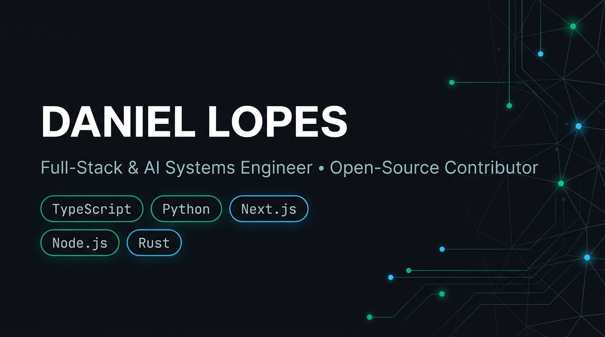

  

### 👋 About Me

Software engineer focused on **full-stack TypeScript/JavaScript**, **Python automation**, **AI systems**, and **open-source contributions**. I enjoy digging into real-world bugs, verifying root causes with clean automated tests, and shipping maintainable pull requests.

- 🔭 **Currently working on:** Open-source bug fixes, full-stack web apps, and developer tooling
- 🛠️ **Core Stack:** `TypeScript` · `JavaScript` · `React` · `React Native` · `Next.js` · `Node.js` · `Python` · `PostgreSQL` · `Docker`
- ✅ **Engineering principles:** Root-cause analysis first, minimal clean diffs, strict regression testing, zero bloat

---

### 🚀 Featured Open-Source Projects · [Live Developer Storefront &amp; CLI Hub →](https://danlopes18-ctrl.github.io/)

- **[`ai-agent-guardrails-lite`](https://github.com/danlopes18-ctrl/ai-agent-guardrails-lite)** — Zero-dependency Node.js `PreToolUse` security hooks (dangerous shell blocker, 11-pattern masked secret guard, protected files guard) + 14-rule OWASP PR Security Auditor for Claude Code, Cursor & Antigravity · [Full 10-Hook + 8-Rulebook + 12-Skill Engineering OS →](https://danlopes3.gumroad.com/l/ai-coding-guardrails-os)
- **[`mcp-starter-suite-lite`](https://github.com/danlopes18-ctrl/mcp-starter-suite-lite)** — 3 hardened, zero-dependency Node.js MCP servers (Filesystem Sandbox, Git Intelligence, Env Security Auditor) + Universal Stdio Inspector CLI · [Full 12-Server Production MCP Suite →](https://danlopes3.gumroad.com/l/production-mcp-suite)
- **[`ai-automation-vault-lite`](https://github.com/danlopes18-ctrl/ai-automation-vault-lite)** — 5 production n8n workflows (zero community plugins) + a zero-dependency Node.js MCP server (`mcp-webhook-runner`) for Claude Code, Cursor & Antigravity · [Full 25-Workflow + 3-MCP PRO Vault →](https://danlopes3.gumroad.com/l/ai-automation-vault)
- 🎁 **[Complete AI Engineering Stack Bundle (All 3 Pro Suites · Save $38 →)](https://danlopes3.gumroad.com/l/complete-ai-engineering-stack)** — 25 n8n Workflows + 15 Zero-Dep MCP Servers + 10 Security Guardrails & CLIs + 12 Rulebooks + 12 Skills (Commercial License)
- ⚡ **[Apify Store Cloud Actors & MCP Tools (`apify.com/danlopes18` →)](https://apify.com/danlopes18)** — Zero-browser Pay-per-Event APIs & MCP tools: [Site Intel & AI-Readiness Auditor](https://apify.com/danlopes18/apify-site-intel-ai-auditor), [Fast LLM Markdown & Sitemap Crawler](https://apify.com/danlopes18/apify-llm-markdown-crawler), and [GitHub Org & Repo Intelligence](https://apify.com/danlopes18/apify-github-devtool-org-intel)

---

### 🧩 Core Areas of Focus

| Domain | Technologies |
| :--- | :--- |
| **Frontend & Mobile** | React, React Native, Next.js, TypeScript, Tailwind CSS |
| **Backend & APIs** | Node.js, Python, REST / GraphQL, PostgreSQL, Redis, Drizzle / Prisma |
| **Automation & AI** | LLM integrations, agent workflows, data pipelines, CLI tooling |
| **Quality & DevOps** | Jest / Vitest, Pytest, GitHub Actions, Docker, Linux |

---

  Open to open-source collaborations, high-impact bug fixes, and engineering bounties · <a href="https://www.upwork.com/freelancers/~017cd1009178a92a66">Upwork Profile</a>

